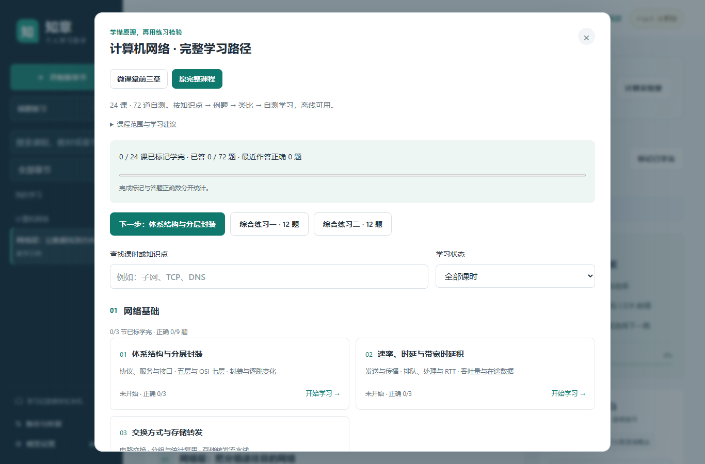

# 知章 学习助手

一个运行在自己电脑上的学习工具。围绕章节组织讲解、例题和自测，保存笔记与进度；可直接体验内置计网课程，也可导入资料并配置模型服务辅助整理。

**技术栈：Python · FastAPI · SQLite · 原生 JavaScript**



## 可以做什么

- 离线学习内置计算机网络课程，使用章节导航、知识点、分步例题和自测。
- 导入 PDF、Markdown、TXT 或粘贴正文，查看资料范围后整理章节。
- 保存笔记、学习进度、错题与学习活动记录，导出 Markdown 或打印讲义。
- 使用 IPv4 子网划分、存储转发时延和 CRC 计算实验。
- 通过 JSON 备份与恢复本机学习数据。
- 配置兼容的模型服务后，进行章节生成和追问；未配置时仍能使用内置课程。

内置内容是通用学习材料，不是指定教材全文、历年真题或实时模型生成结果。模型生成内容仍需要结合原始资料核对。

## 快速启动

需要 Python 3.11 或以上版本。从仓库根目录执行：

```bash
python -m venv .venv
```

激活虚拟环境：Windows PowerShell 执行 `.venv\Scripts\Activate.ps1`，Linux / macOS 执行 `source .venv/bin/activate`。随后执行：

```bash
python -m pip install -r requirements.txt
python start.py
```

浏览器打开 `http://127.0.0.1:8765`。Windows 也可使用仓库内的 `启动学习助手.bat`。指定端口且不自动打开浏览器：

```bash
python start.py --port 8766 --no-browser
```

## 测试

```bash
python -m unittest tests.test_app
```

测试使用临时数据库和本地假模型服务，覆盖资料处理、章节任务、笔记、练习、课程与备份等后端行为，不依赖真实 API 密钥。浏览器测试需要安装 `requirements-dev.txt` 中的依赖，运行方式见 [验证文档](docs/validation.md)。

本次公开整理的实际验证记录见 [展示版本验证](docs/SHOWCASE_VALIDATION.md)。

## 目录

| 目录或文件 | 用途 |
| --- | --- |
| `backend/` | API、模型适配、课程、学习记录和 SQLite 存储 |
| `dist/` | 浏览器页面、交互逻辑与样式，直接作为前端资源使用 |
| `tests/` | 后端与浏览器测试、本地假模型服务 |
| `examples/` | 可导入的学习材料示例 |
| `docs/` | 架构、课程范围、验证与实现说明 |
| `start.py` | 本地服务启动入口 |

[完整使用指南](USER_GUIDE.md) · [架构说明](docs/architecture.md) · [从零实现](docs/从零实现.md)

## 数据与运行边界

学习数据库和模型配置保存在本机 `data/` 中，未包含在仓库内。不要上传自己的 API 密钥、学习数据库或导入的教材原文。服务默认仅监听 `127.0.0.1`，本项目没有面向公网的多用户认证体系。

项目为个人学习实践，使用 AI 辅助开发与内容整理。第三方依赖的授权以各自项目为准；学习材料的来源和适用条件见课程指南。
