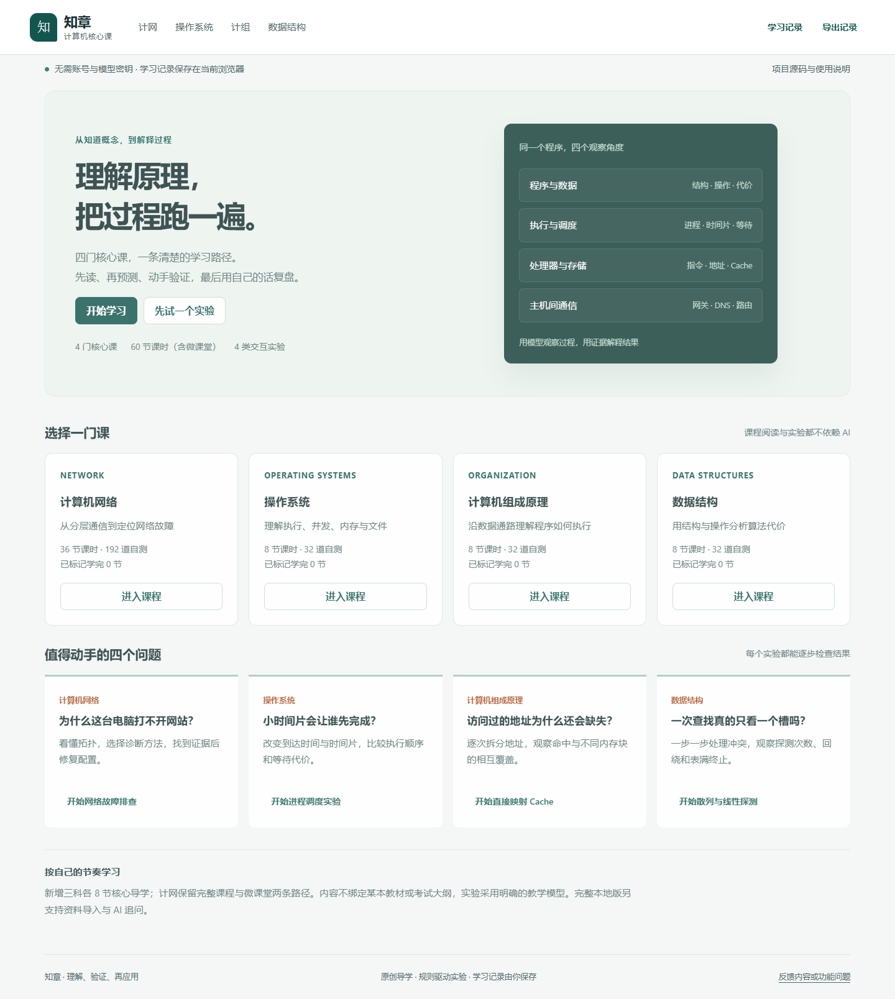

# 知章 · 计算机核心课学习与实验

围绕计算机网络、操作系统、计算机组成原理、数据结构，提供原创导学、分步例题、自测与可操作实验。核心学习不依赖 AI；本地完整版另支持资料导入和模型追问。

**技术栈：Python · FastAPI · SQLite · 原生 JavaScript**

[在线体验四科课程与实验](https://zhizhang-core-courses.nuttsmidt.chatgpt.site) · [使用与实现说明](docs/CORE_COURSES.md) · [实际验收记录](docs/FOUR_SUBJECT_IMPLEMENTATION.md)



四门科目共 60 节课时、288 道自测（含保留的计网微课堂路径）。新增三科各 8 节核心导学、32 道自测，非指定教材或考试大纲的完整覆盖。

| 科目 | 代表实验 |
| --- | --- |
| 计算机网络 | 子网、网关、DNS、静态路由故障排查与迁移挑战 |
| 操作系统 | FCFS / RR 调度时间线、就绪队列和时间指标 |
| 计算机组成原理 | 直接映射 Cache、地址拆分、冷缺失与冲突覆盖 |
| 数据结构 | 散列插入与查找、线性探测、回绕和满表终止 |

实验采用“预测 → 操作 → 规则验证 → 变式 → 复盘”，支持单步、回放、分级提示、刷新后恢复及过程导出。规则由可测试代码实现，不依赖模型评分。详见[四科使用与实现说明](docs/CORE_COURSES.md)。

## 可以做什么

- 离线学习内置计算机网络课程，使用章节导航、知识点、分步例题和自测。
- 阅读新增操作系统、计组、数据结构核心导学，并进入对应交互实验。
- 导入 PDF、Markdown、TXT 或粘贴正文，查看资料范围后整理章节。
- 保存笔记、学习进度、错题与学习活动记录，导出 Markdown 或打印讲义。
- 使用 IPv4 子网划分、存储转发时延和 CRC 计算实验。
- 通过 JSON 备份与恢复本机学习数据。
- 配置兼容的模型服务后，进行章节生成和追问；未配置时仍能使用内置课程。

内置内容是通用学习材料，不是指定教材全文、历年真题或实时模型生成结果。模型生成内容仍需要结合原始资料核对。

## 快速启动

需要 Python 3.11 或以上版本。从仓库根目录执行：

```bash
python -m venv .venv
```

激活虚拟环境：Windows PowerShell 执行 `.venv\Scripts\Activate.ps1`，Linux / macOS 执行 `source .venv/bin/activate`。随后执行：

```bash
python -m pip install -r requirements.txt
python start.py
```

浏览器打开 `http://127.0.0.1:8765`。Windows 也可使用仓库内的 `启动学习助手.bat`。指定端口且不自动打开浏览器：

```bash
python start.py --port 8766 --no-browser
```

在首页点击“四科导学与实验”，或访问 `http://127.0.0.1:8765/academy/?local=1`。此入口的课时记录与原界面使用同一数据库；实验记录保存在浏览器，可单独导出。

## 测试

```bash
python -m unittest tests.test_app
```

课程与实验扩展检查：

```bash
python -m unittest tests.network_course_check tests.microclass_check tests.academy_check
node --test tests/academy_engines.test.mjs
python -m tests.academy_browser
```

Node.js 仅用于 JavaScript 实验规则测试；普通使用无需安装。浏览器验收使用临时数据库，安装步骤和记录边界见[四科说明](docs/CORE_COURSES.md)。

测试使用临时数据库和本地假模型服务，覆盖资料处理、章节任务、笔记、练习、课程与备份等后端行为，不依赖真实 API 密钥。浏览器测试需要安装 `requirements-dev.txt` 中的依赖，运行方式见 [验证文档](docs/validation.md)。

本次公开整理的实际验证记录见 [展示版本验证](docs/SHOWCASE_VALIDATION.md)。

四科扩展的验证记录另见[实现与验收记录](docs/FOUR_SUBJECT_IMPLEMENTATION.md)，后续真实反馈可按[自愿试用模板](docs/CORE_COURSES_TRYOUT.md)收集。

## 目录

| 目录或文件 | 用途 |
| --- | --- |
| `backend/` | API、模型适配、课程、学习记录和 SQLite 存储 |
| `dist/` | 浏览器页面、交互逻辑与样式，直接作为前端资源使用 |
| `dist/academy/` | 本地与公开版共用的四科阅读、存档及实验规则 |
| `tests/` | 后端与浏览器测试、本地假模型服务 |
| `examples/` | 可导入的学习材料示例 |
| `docs/` | 架构、课程范围、验证与实现说明 |
| `start.py` | 本地服务启动入口 |

[完整使用指南](USER_GUIDE.md) · [架构说明](docs/architecture.md) · [从零实现](docs/从零实现.md)

## 数据与运行边界

学习数据库和模型配置保存在本机 `data/` 中，未包含在仓库内。不要上传自己的 API 密钥、学习数据库或导入的教材原文。服务默认仅监听 `127.0.0.1`，本项目没有面向公网的多用户认证体系。

项目为个人学习实践，使用 AI 辅助开发与内容整理。第三方依赖的授权以各自项目为准；学习材料的来源和适用条件见课程指南。

四科公开版只包含原创课程包和静态实验模块。公开版学习记录保存在当前浏览器，不自动上传到服务器；课程内容和界面测试通过不等于已证明提升学习成绩。
